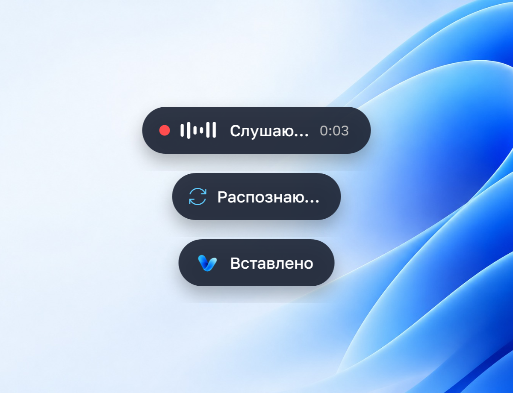
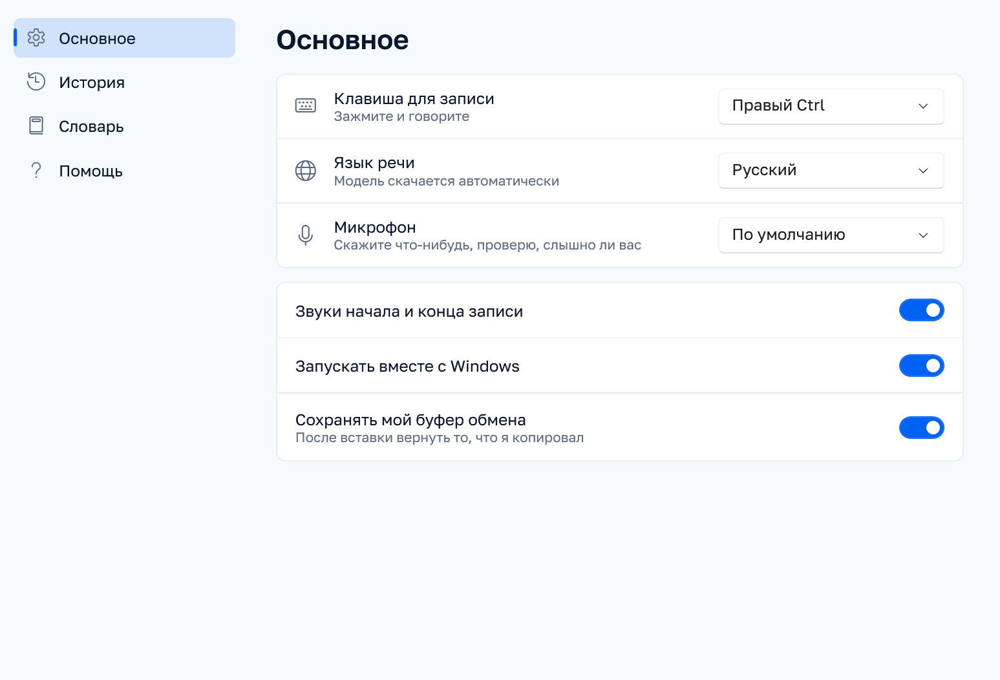
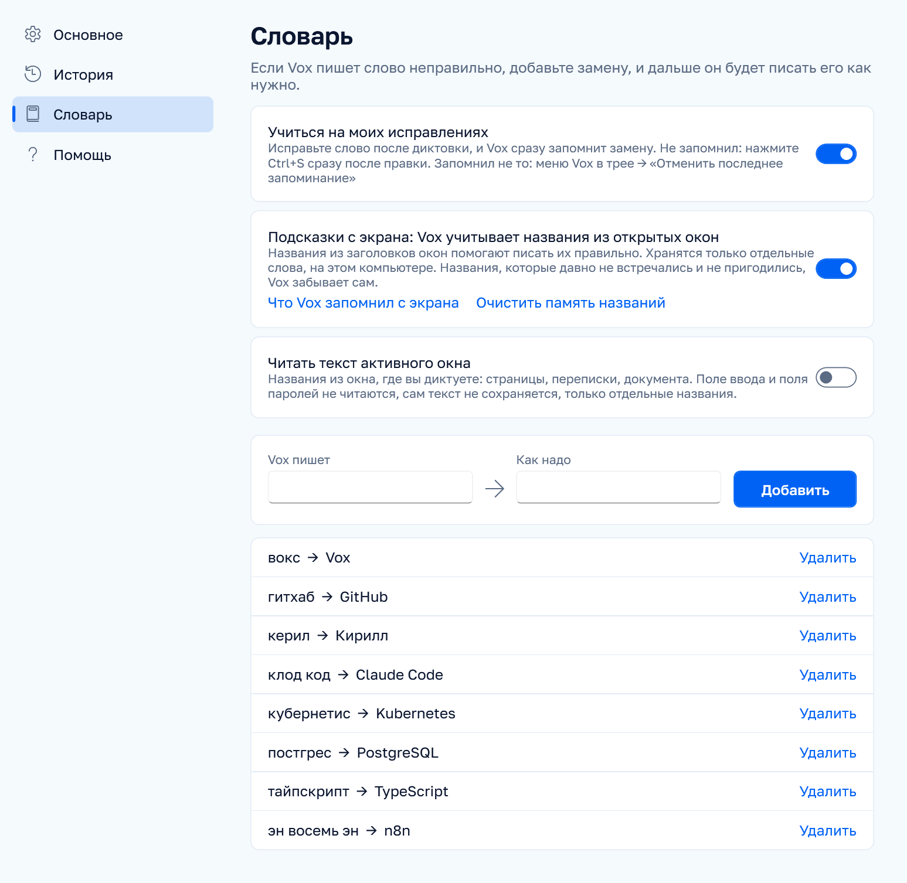
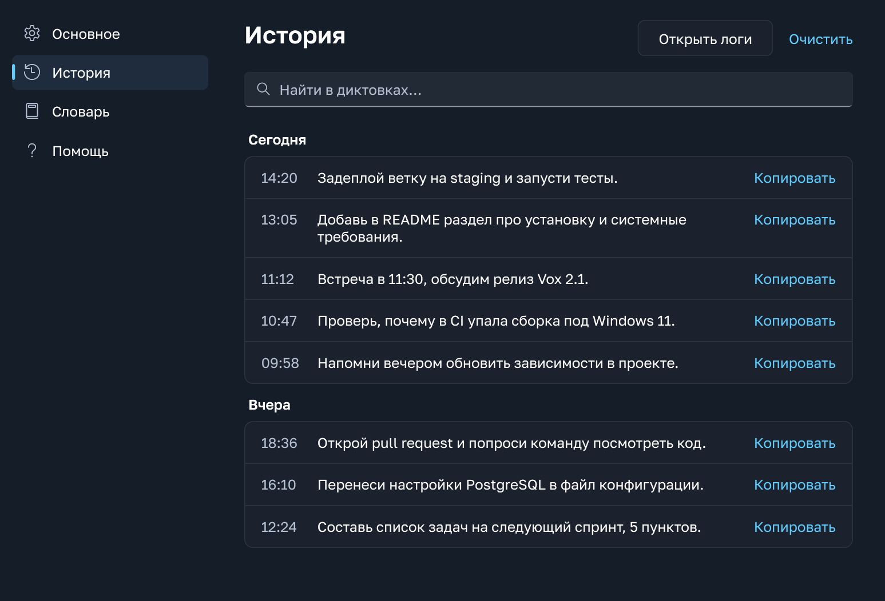
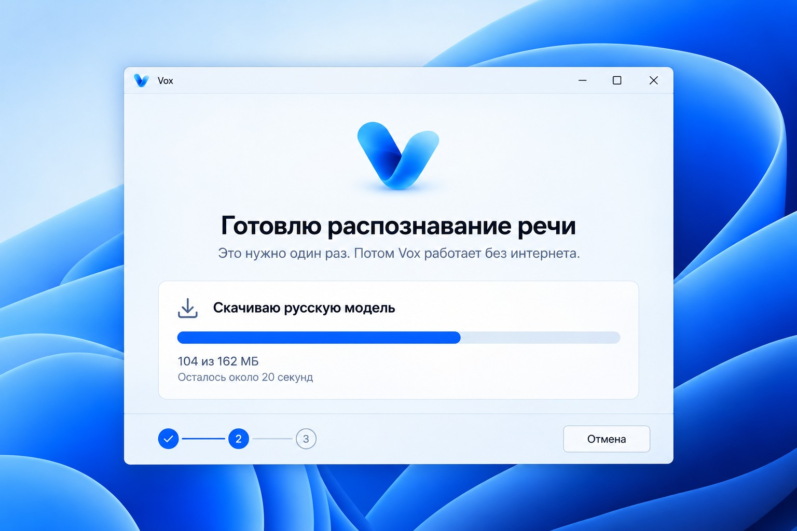
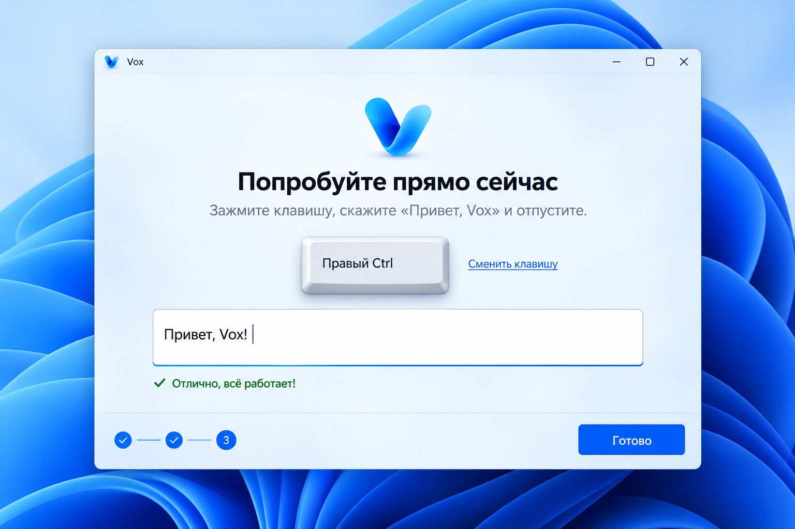

<p align="center">
  <a href="https://github.com/privatekey7/Vox/releases/latest">
    <picture>
      <source media="(prefers-color-scheme: dark)" srcset="docs/readme/banner-dark.png">
      <source media="(prefers-color-scheme: light)" srcset="docs/readme/banner-light.png">
      
    </picture>
  </a>
</p>

<p align="center">
  <a href="README.md">Русский</a> • <b>English</b>
</p>

<h3 align="center">Hold a key, speak, let go. The text lands where your cursor is.</h3>

<p align="center">
  Voice typing for Windows. Works in any app, with no internet and no subscription.
</p>

<p align="center">
  <a href="https://github.com/privatekey7/Vox/releases/latest"></a>
  <a href="https://github.com/privatekey7/Vox/releases"></a>
  <a href="LICENSE"></a>
  
  
  
</p>

<p align="center">
  <a href="https://github.com/privatekey7/Vox/releases/latest"></a>
  <br>
  <sub>vox-setup.exe · Windows 10 and 11, 64-bit · free</sub>
</p>

<p align="center">
  <a href="#said-and-got">Examples</a> •
  <a href="#how-it-works">How it works</a> •
  <a href="#features">Features</a> •
  <a href="#install">Install</a> •
  <a href="#questions-and-problems">Questions</a> •
  <a href="#privacy">Privacy</a> •
  <a href="#for-developers">Developers</a>
</p>

<!-- Demo. Uncomment once docs/readme/demo.gif exists:
<p align="center">
  
</p>
-->

> Vox is built for Russian speech first: the interface is in Russian, and the dictionary of IT terms is tuned to Russian pronunciation. English and 24 more European languages are recognised by a second model.

## Said and got

Ordinary dictation writes what it hears: «клод опус», «гитхабе», «эн восемь эн». Vox writes it the way you would type it yourself.

| You say | Vox writes | What did it |
|---|---|---|
| пишу в клод опус четыре и пять через клод код | Пишу в **Claude Opus 4.5** через **Claude Code**. | Model names and versions |
| сценарий в эн восемь эн или запиер | Сценарий в **n8n** или **Zapier**. | IT and AI dictionary |
| лежит на гитхабе | Лежит на **GitHub**. | Russian case endings |
| встреча в одиннадцать тридцать, бюджет пятьсот рублей | Встреча в **11:30**, бюджет **500 рублей**. | Numbers, time, money |
| нажми контрол си, потом контрол ви | Нажми **Ctrl+C**, потом **Ctrl+V**. | Keyboard shortcuts |
| добавь юзстейт для счётчика | Добавь **useState** для счётчика | Code |
| открой санвиспер | Открой **Sunwhisper** | Hints from the screen: the name is in the title of an open window |
| п-п-привет всем | **Привет** всем. | Stutters and "uh" are removed |

The examples come from the project's tests in `tests/Vox.Core.Tests`.

## How it works

1. **Hold the right Ctrl key.** Put the cursor where you want the text first. You can pick another key in the settings.
2. **Speak.** A small pill at the bottom of the screen says "Слушаю…" (listening).
3. **Let go.** Vox recognises the speech on your computer and pastes the text at the cursor.

If you press right Ctrl as part of a shortcut such as Ctrl+C, Vox notices and records nothing.

## Features

<table>
<tr>
<td width="50%" valign="top">

**Any window**

Browser, messenger, editor, terminal. The text goes where the cursor is.

</td>
<td width="50%" valign="top">

**Fully offline**

Speech is recognised on your computer. No accounts, no ads, no telemetry.

</td>
</tr>
<tr>
<td valign="top">

**A model for your language**

Russian: GigaAM v3 by Sber. It adds punctuation and writes numbers as digits by itself. English and 24 more European languages: Parakeet TDT v3 by NVIDIA.

</td>
<td valign="top">

**IT and AI dictionary**

About 4,000 terms: Claude, DeepSeek, n8n, useState, GitHub. Only names, models, abbreviations and code are written in Latin letters. Loanwords that have settled in Russian (промпт, токен, деплой) stay in Cyrillic.

</td>
</tr>
<tr>
<td valign="top">

**Understands Russian cases**

«На гитхабе» → «на GitHub», «с керилом» → «с Кириллом». One dictionary entry covers every case ending.

</td>
<td valign="top">

**Learns from your corrections**

Fix a word after dictating and Vox remembers how to write it. If it learned the wrong thing: tray menu → "Отменить последнее запоминание" (undo the last learned word), or Settings → Dictionary.

</td>
</tr>
<tr>
<td valign="top">

**Hints from the screen**

Vox reads the titles of open windows and spells the names of apps and sites that are on screen right now. Keys, passwords and wallet addresses are never remembered. Turn it off in Settings → Dictionary.

</td>
<td valign="top">

**Continues your sentence**

After a comma it starts with a lowercase letter, after a full stop with a capital, and at the start of a field with no extra space.

</td>
</tr>
<tr>
<td valign="top">

**Long dictations**

Up to 10 minutes in one go. Vox splits the recording at pauses and recognises all of it.

</td>
<td valign="top">

**Your clipboard stays**

After pasting, Vox puts back what you had copied: text, images, files. The dictation stays out of the Win+V clipboard history.

</td>
</tr>
<tr>
<td valign="top">

**Recording pill**

The bottom of the screen shows what is going on: listening, recognising, pasted, did not catch that, the microphone is silent, or could not paste.

</td>
<td valign="top">

**History and themes**

Every dictation, with search and a Copy button. Light and dark theme, following Windows.

</td>
</tr>
<tr>
<td valign="top">

**Shortcuts by voice**

«Контрол си» → Ctrl+C, «альт эф четыре» → Alt+F4. Ordinary phrases such as «контроль качества» are left alone.

</td>
<td valign="top">

**Transfer and remote desktop**

The dictionary, learned corrections and settings go into one file for another computer. Dictation also works in a RustDesk window: your computer records, the remote one gets the text.

</td>
</tr>
</table>

Vox learns corrections in most apps: Notepad, Word, browsers, Telegram, Notepad++. Some apps do not let other programs read their text (some code editors, games). For those, add the word by hand in Settings → Dictionary.

**New in 2.1.** Vox tells you when a new version is out (you can turn the check off in the settings). Licenses of third-party components are shown in Settings → Help. Models are downloaded from the `models-1` release of this repository.

<!-- Interface screenshots. Uncomment once real window screenshots are in docs/readme/:
<table>
<tr>
<td width="50%" align="center"><br><sub>Recording pill</sub></td>
<td width="50%" align="center"><br><sub>Settings</sub></td>
</tr>
<tr>
<td align="center"><br><sub>Dictionary</sub></td>
<td align="center"><br><sub>History</sub></td>
</tr>
</table>
-->

### Tray menu

| Item | What it does |
|---|---|
| **Скопировать последнюю диктовку** (copy the last dictation) | Puts the last dictation on the clipboard |
| **История** (history) | Every dictation, with search and a Copy button |
| **Настройки** (settings) | Key, speech language, microphone, sounds, autostart, clipboard, dictionary |
| **Отменить последнее запоминание** (undo the last learned word) | Removes the last word Vox learned by itself |
| **Выход** (exit) | Closes Vox |

A click on the tray icon opens the settings.

## Install

1. Download `vox-setup.exe` from [Releases](https://github.com/privatekey7/Vox/releases/latest) and run it.
2. Tick "Start Vox with Windows" if you like and click **Install**.
3. On first start, choose the speech language. Vox downloads the model once: about 160 MB for Russian, about 465 MB for English.
4. Try it right in the window: hold **right Ctrl**, say "Привет, Vox" and let go.

<table>
<tr>
<td width="50%" align="center"><br><sub>Step 3. The model is downloaded once</sub></td>
<td width="50%" align="center"><br><sub>Step 4. Try it right in the window</sub></td>
</tr>
</table>

**Upgrading from 1.x.** Vox 2 installs over version 1.x. Your history, dictionary, settings and already downloaded models are kept.

> The models are hosted on GitHub. If the download does not start, turn on a VPN and try again.

## Questions and problems

<details>
<summary><b>The pill says «Не расслышал» (did not catch that)</b></summary>

The reason is in the log (**Settings → Help → «Открыть логи»**):

- `Too quiet`: the sound is too quiet. Pick another microphone in the settings or speak closer.
- `Model returned no text`: the speech was not understood. Try again, more clearly.

A very short press, under half a second, counts as accidental, and Vox shows nothing.
</details>

<details>
<summary><b>The pill says «Микрофон молчит» (the microphone is silent)</b></summary>

The microphone gives no sound: another app took it, the headset disconnected, or its mute button is pressed. Check that button. Vox tries to reopen the microphone right away. If the message stays, reconnect the headset. If that does not help, restart the computer.
</details>

<details>
<summary><b>The key does not work in some apps</b></summary>

Windows does not let ordinary programs catch keys in windows that run as administrator. Vox works as usual in all other windows.
</details>

<details>
<summary><b>The text was not pasted</b></summary>

If another app keeps the clipboard busy (RustDesk sending it to a remote computer, for example), Vox types the text itself, without the clipboard. If the pill says «Не вставилось» or the app blocks pasting, take the text from **tray → «Скопировать последнюю диктовку»** or from **History** and press **Ctrl+V**. If the window runs as administrator, Windows blocks the paste. The text stays on the clipboard, just press **Ctrl+V**.
</details>

<details>
<summary><b>The model does not download</b></summary>

The models are hosted on GitHub. Check your connection and try again. If GitHub does not open, a VPN may help. Vox checks every model file against its checksum, so a broken or replaced download is never installed.
</details>

<details>
<summary><b>SmartScreen warns about the installer</b></summary>

Click **"More info" → "Run anyway"**. The installer is not signed with a certificate yet. GitHub Actions builds it from the open source in this repository.

Download Vox only from [Releases](https://github.com/privatekey7/Vox/releases/latest). There are two ways to check that the file was not replaced:

- **Checksum.** In PowerShell, in the folder with the file, run `(Get-FileHash .\vox-setup.exe -Algorithm SHA256).Hash` and compare the result with the SHA-256 in the release notes. The same hash is in the build summary on the Actions tab.
- **Build provenance.** If you have [GitHub CLI](https://cli.github.com/), run `gh attestation verify vox-setup.exe --repo privatekey7/Vox`. It confirms the file was built from this repository. Works for releases from 2.0 on.
</details>

## Privacy

- Your voice, dictated texts and settings are never sent anywhere.
- Vox connects to the internet in two cases: to download a speech model and to learn the number of the latest version. The version check can be turned off in the settings.
- Details: [Privacy policy](docs/privacy.md#vox-privacy-policy) (what Vox stores and when it goes online) and [Code signing policy](docs/code-signing-policy.md) (how the installer is built and signed).
- Found a vulnerability? See [SECURITY.md](SECURITY.md).

### Where the data lives

| Path | What is there |
|---|---|
| `C:\Program Files\Vox\` | The program |
| `%APPDATA%\vox\models\` | Speech models* |
| `%APPDATA%\vox\logs\vox.log` | Log |
| `%APPDATA%\vox\vox_data.db` | History and dictionary |
| `%APPDATA%\vox\config.json` | Settings |

\* If your Windows user name has non-Latin letters, the models are stored in `C:\ProgramData\Vox\models\`: the speech engine cannot open files on such paths. Vox checks every model file against its checksum on download and on every start, so it will not load a replaced model.

### Uninstalling

- **Your data only:** Settings → Help → «Удалить мои данные…» (delete my data).
- **All of Vox:** Windows Settings → Apps. The models are always removed. History, dictionary, settings and logs are removed only if you answer "Yes" when the uninstaller asks about them. A silent uninstall (`/SILENT`) keeps them.
- Installing a new version over the old one deletes nothing.

## For developers

Vox is written in C# (.NET 10, WPF). Recognition: [sherpa-onnx](https://github.com/k2-fsa/sherpa-onnx).

```bash
# tests without models (also run on Linux and macOS)
dotnet test Vox.sln --filter "Category!=Models"

# plus the tests on real models
VOX_TEST_MODELS=/path/to/models dotnet test Vox.sln

# build the app
dotnet publish src/Vox.App -c Release -r win-x64 --self-contained -o publish

# run saved dictation recordings through a model and the whole text pipeline
dotnet run --project tools/Vox.Replay -- --audio path/to/recordings --model gigaam --models /path/to/models

# the same, with GigaAM, Parakeet and Qwen3-ASR side by side
dotnet run --project tools/Vox.Replay -- --audio path/to/recordings --compare --models /path/to/models
```

Saving dictation recordings is turned on in Settings → Help → «Для разработчика» → «Сохранять записи диктовок».

GitHub Actions builds the installer `vox-setup.exe`: `.github/workflows/build.yml`, then Inno Setup (`vox.iss`).

NuGet package versions are pinned in each project's `packages.lock.json`, and CI restores strictly by them (`--locked-mode`). After adding or updating a package, run `dotnet restore` and commit the changed `packages.lock.json` files.

| Project | What is inside |
|---|---|
| `src/Vox.Core` | Text processing, splitting a recording at pauses, model catalog and download, settings, history (SQLite) |
| `src/Vox.Engine` | Recognition through sherpa-onnx |
| `src/Vox.App` | The Windows app: hotkey, microphone, paste, tray, windows |

Decisions and design: `docs/adr/`, `docs/design/v2/` (in Russian). Version 1.x (Python) is in the repository history.

### Third-party data and fonts

Vox's code is under the MIT license. Some files have licenses of their own. The full list with every package is in [THIRD-PARTY-NOTICES.txt](THIRD-PARTY-NOTICES.txt); in the installed app it opens from Settings → Help → Licenses.

| File | What it is | License |
|---|---|---|
| `src/Vox.Core/Text/Data/common-words.txt.gz` | 48k frequent Russian word forms ([hermitdave/FrequencyWords](https://github.com/hermitdave/FrequencyWords)), so that self-learning leaves ordinary words alone | CC BY-SA 4.0 (`common-words.LICENSE.md`) |
| `src/Vox.Core/Text/Data/english.txt.gz` | 281k English word forms ([SCOWL](http://wordlist.aspell.net/), Kevin Atkinson), so that search by sound does not turn ordinary words into brands | MIT-like, parts public domain (`english.LICENSE.md`) |
| `src/Vox.Core/Text/Data/ru_RU.dic.gz`, `ru_RU.aff.gz` | Russian Hunspell dictionary (A. I. Lebedev, from [LibreOffice](https://github.com/LibreOffice/dictionaries/tree/master/ru_RU)), so that names from the screen do not replace Russian words | BSD (`ru_RU.LICENSE.md`) |
| `src/Vox.App/Assets/Fonts/GolosText-*.ttf` | Golos Text font (Paratype) | SIL OFL 1.1 (`OFL-GolosText.txt`) |
| Speech models (downloaded on first start) | GigaAM, Parakeet through sherpa-onnx | Licenses of the model authors |

## Contact

News, updates, questions and ideas: Telegram [@privatekey_ai](https://t.me/privatekey_ai).

Bugs and ideas are welcome in [Issues](https://github.com/privatekey7/Vox/issues). Please do not attach the whole log or the `vox_data.db` file: they may contain the texts of your dictations.

## License

[MIT](LICENSE)
