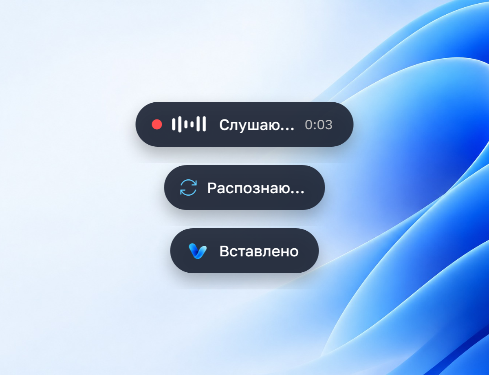
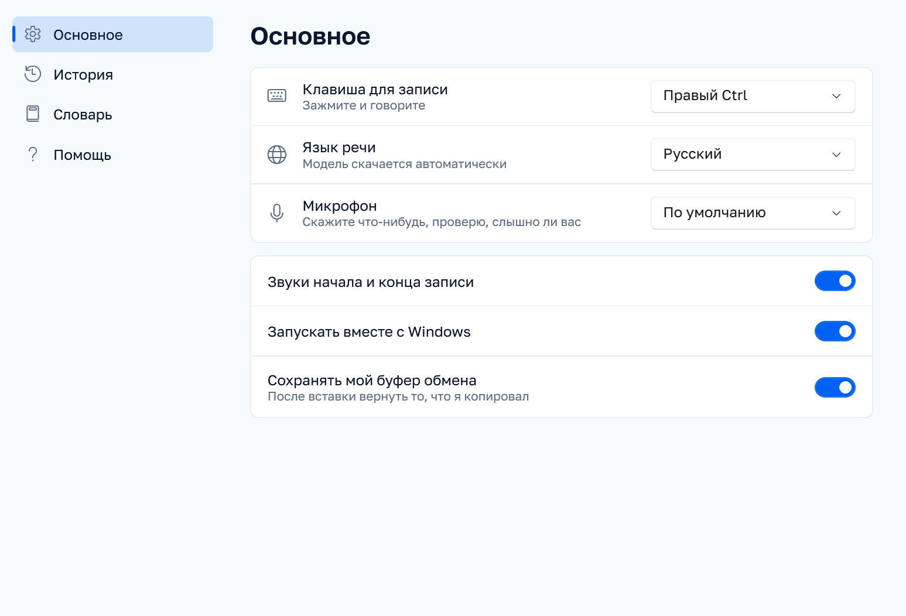
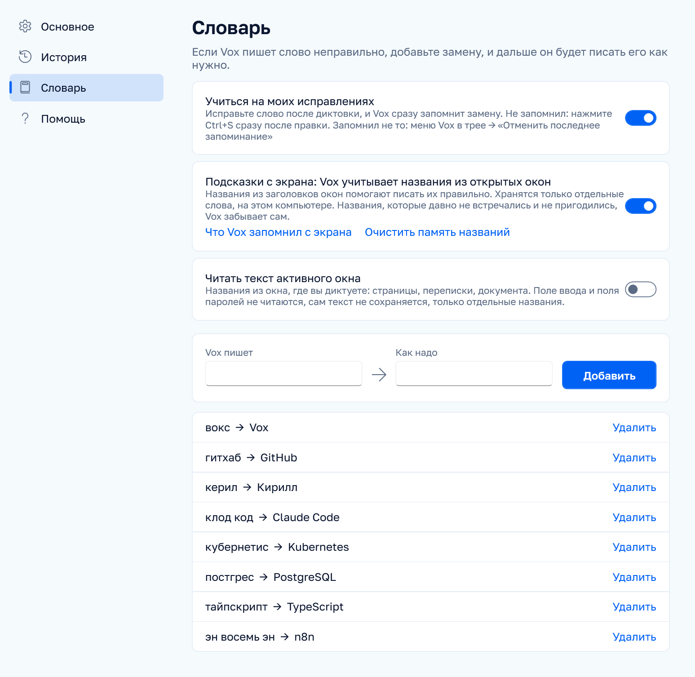
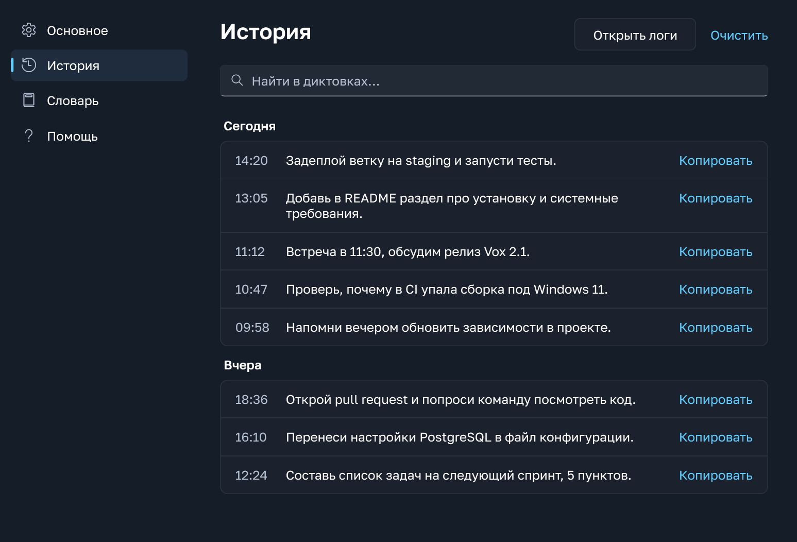
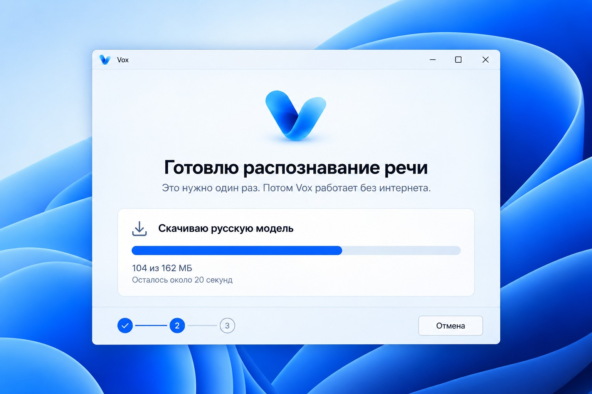
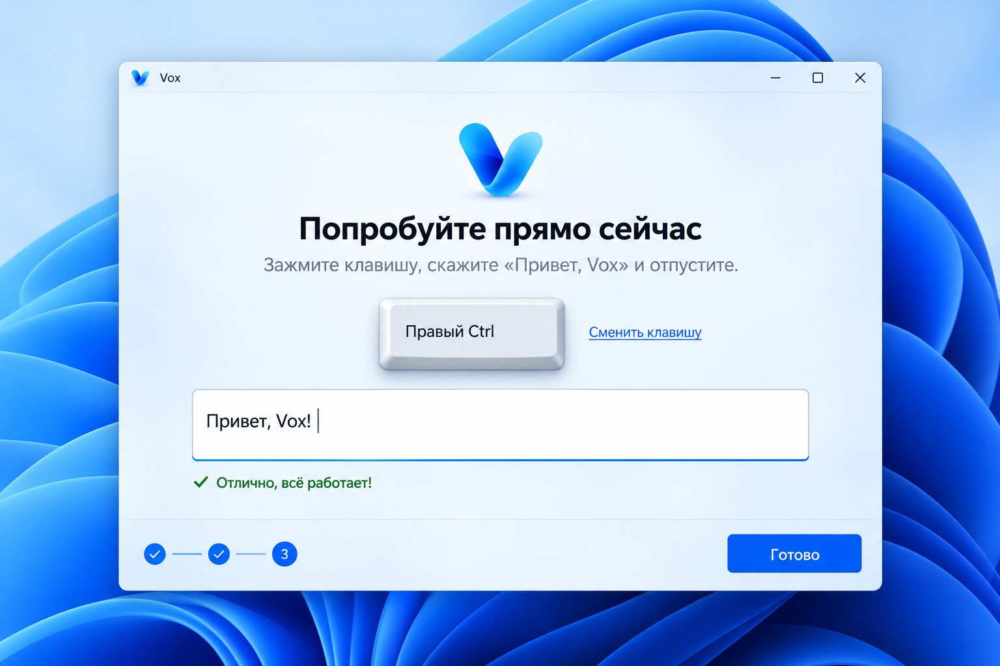

<p align="center">
  <a href="https://github.com/privatekey7/Vox/releases/latest">
    <picture>
      <source media="(prefers-color-scheme: dark)" srcset="docs/readme/banner-dark.png">
      <source media="(prefers-color-scheme: light)" srcset="docs/readme/banner-light.png">
      
    </picture>
  </a>
</p>

<p align="center">
  <b>Русский</b> • <a href="README.en.md">English</a>
</p>

<h3 align="center">Зажми клавишу, скажи, отпусти. Текст появится там, где курсор.</h3>

<p align="center">
  Голосовой ввод для Windows. Работает в любой программе, без интернета и без подписок.
</p>

<p align="center">
  <a href="https://github.com/privatekey7/Vox/releases/latest"></a>
  <a href="https://github.com/privatekey7/Vox/releases"></a>
  <a href="LICENSE"></a>
  
  
  
</p>

<p align="center">
  <a href="https://github.com/privatekey7/Vox/releases/latest"></a>
  <br>
  <sub>vox-setup.exe · Windows 10 и 11, 64 бита · бесплатно</sub>
</p>

<p align="center">
  <a href="#сказал-и-получил">Примеры</a> •
  <a href="#как-это-работает">Как это работает</a> •
  <a href="#возможности">Возможности</a> •
  <a href="#установка">Установка</a> •
  <a href="#вопросы-и-проблемы">Вопросы</a> •
  <a href="#конфиденциальность">Конфиденциальность</a> •
  <a href="#для-разработчиков">Разработчикам</a>
</p>

<!-- Демо. Раскомментировать, когда появится файл docs/readme/demo.gif:
<p align="center">
  
</p>
-->

## Сказал и получил

Обычная диктовка пишет то, что слышит: «клод опус», «гитхабе», «эн восемь эн». Vox пишет так, как вы написали бы сами.

| Вы говорите | Vox пишет | Что сработало |
|---|---|---|
| пишу в клод опус четыре и пять через клод код | Пишу в **Claude Opus 4.5** через **Claude Code**. | Названия и версии моделей |
| сценарий в эн восемь эн или запиер | Сценарий в **n8n** или **Zapier**. | Словарь IT и ИИ |
| лежит на гитхабе | Лежит на **GitHub**. | Падежи |
| встреча в одиннадцать тридцать, бюджет пятьсот рублей | Встреча в **11:30**, бюджет **500 рублей**. | Числа, время, деньги |
| нажми контрол си, потом контрол ви | Нажми **Ctrl+C**, потом **Ctrl+V**. | Сочетания клавиш |
| добавь юзстейт для счётчика | Добавь **useState** для счётчика | Код |
| открой санвиспер | Открой **Sunwhisper** | Подсказки с экрана: это название есть в заголовке открытого окна |
| п-п-привет всем | **Привет** всем. | Запинки и «э-э» убираются |

Примеры взяты из тестов проекта: `tests/Vox.Core.Tests`.

## Как это работает

1. **Зажмите правый Ctrl.** Курсор должен стоять там, где нужен текст. Клавишу можно сменить в настройках.
2. **Говорите.** Внизу экрана появится плашка «Слушаю…».
3. **Отпустите.** Vox распознает речь на вашем компьютере и вставит текст у курсора.

Если вы нажали правый Ctrl как часть сочетания (например, Ctrl+C), Vox это поймёт и ничего не запишет.

## Возможности

<table>
<tr>
<td width="50%" valign="top">

**Любое окно**

Браузер, мессенджер, редактор, терминал. Текст вставляется туда, где стоит курсор.

</td>
<td width="50%" valign="top">

**Полностью офлайн**

Речь распознаётся на вашем компьютере. Нет аккаунтов, рекламы и телеметрии.

</td>
</tr>
<tr>
<td valign="top">

**Модель под ваш язык**

Русский: GigaAM v3 от Сбера. Сама ставит знаки препинания и пишет числа цифрами. English и ещё 24 европейских языка: Parakeet TDT v3 от NVIDIA.

</td>
<td valign="top">

**Словарь IT и ИИ**

Около 4000 терминов: Claude, DeepSeek, n8n, useState, GitHub. Латиницей пишутся только названия, модели, аббревиатуры и код. Прижившиеся слова (промпт, токен, деплой) остаются по-русски.

</td>
</tr>
<tr>
<td valign="top">

**Понимает падежи**

«На гитхабе» → «на GitHub», «с керилом» → «с Кириллом». Одна запись в словаре работает во всех падежах.

</td>
<td valign="top">

**Учится на ваших исправлениях**

Исправили слово после диктовки, и Vox запомнил, как его писать. Запомнил не то: меню в трее → «Отменить последнее запоминание» или Настройки → Словарь.

</td>
</tr>
<tr>
<td valign="top">

**Подсказки с экрана**

Vox смотрит заголовки открытых окон и правильно пишет названия программ и сайтов, которые сейчас на экране. Ключи, пароли и адреса кошельков не запоминаются. Выключается в Настройки → Словарь.

</td>
<td valign="top">

**Продолжает фразу**

После запятой пишет со строчной буквы, после точки с заглавной, в начале поля без лишнего пробела.

</td>
</tr>
<tr>
<td valign="top">

**Длинные диктовки**

До 10 минут подряд. Vox делит запись по паузам и распознаёт её целиком.

</td>
<td valign="top">

**Буфер обмена на месте**

После вставки Vox возвращает то, что вы копировали: текст, картинки, файлы. Диктовка не попадает в журнал Win+V.

</td>
</tr>
<tr>
<td valign="top">

**Плашка записи**

Внизу экрана видно, что происходит: «Слушаю…», «Распознаю…», «Вставлено», «Не расслышал», «Микрофон молчит» или «Не вставилось».

</td>
<td valign="top">

**История и темы**

Все диктовки с поиском и кнопкой «Копировать». Светлая и тёмная тема, как в Windows.

</td>
</tr>
<tr>
<td valign="top">

**Сочетания клавиш голосом**

«Контрол си» → Ctrl+C, «альт эф четыре» → Alt+F4. «Контроль качества» и другие обычные фразы не меняются.

</td>
<td valign="top">

**Перенос и удалённый доступ**

Словарь, исправления и настройки сохраняются в один файл для другого компьютера. Диктовка работает и в окне RustDesk: записывает ваш компьютер, текст приходит на удалённый.

</td>
</tr>
</table>

Vox запоминает исправления в большинстве программ: Блокнот, Word, браузер, Telegram, Notepad++. Некоторые программы не дают прочитать свой текст (часть редакторов кода, игры). Для них слово можно добавить вручную в Настройки → Словарь.

**Новое в 2.1.** Vox сообщает, когда вышла новая версия (проверку можно выключить в настройках). Лицензии сторонних компонентов видны в Настройки → Помощь. Модели скачиваются из релиза `models-1` этого репозитория.

<table>
<tr>
<td width="50%" align="center"><br><sub>Плашка записи</sub></td>
<td width="50%" align="center"><br><sub>Настройки</sub></td>
</tr>
<tr>
<td align="center"><br><sub>Словарь</sub></td>
<td align="center"><br><sub>История</sub></td>
</tr>
</table>

### Меню в трее

| Пункт | Что делает |
|---|---|
| **Скопировать последнюю диктовку** | Кладёт последнюю диктовку в буфер обмена |
| **История** | Все диктовки с поиском и кнопкой «Копировать» |
| **Настройки** | Клавиша, язык речи, микрофон, звуки, автозапуск, буфер обмена, словарь |
| **Отменить последнее запоминание** | Убирает последнее слово, которое Vox выучил сам |
| **Выход** | Закрывает Vox |

Клик по значку открывает настройки.

## Установка

1. Скачайте `vox-setup.exe` со страницы [Releases](https://github.com/privatekey7/Vox/releases/latest) и запустите.
2. Отметьте по желанию «Запускать Vox при старте Windows» и нажмите **Установить**.
3. При первом запуске выберите язык речи. Vox один раз скачает модель: около 160 МБ для русского, около 465 МБ для английского.
4. Попробуйте прямо в окне: зажмите **правый Ctrl**, скажите «Привет, Vox» и отпустите.

<table>
<tr>
<td width="50%" align="center"><br><sub>Шаг 3. Модель скачивается один раз</sub></td>
<td width="50%" align="center"><br><sub>Шаг 4. Проверка прямо в окне</sub></td>
</tr>
</table>

**Обновление с 1.x.** Vox 2 ставится поверх версии 1.x. История, словарь, настройки и уже скачанные модели сохраняются.

> Модели лежат на GitHub. Если загрузка не идёт, включите VPN и попробуйте снова.

## Вопросы и проблемы

<details>
<summary><b>После записи на плашке «Не расслышал»</b></summary>

Причина записана в логе (**Настройки → Помощь → Открыть логи**):

- `Too quiet`: звук слишком тихий. Выберите другой микрофон в настройках или говорите ближе.
- `Model returned no text`: речь не разобрана. Попробуйте ещё раз, чётче.

Если нажать клавишу совсем коротко, меньше чем на полсекунды, Vox считает это случайным нажатием и ничего не показывает.
</details>

<details>
<summary><b>На плашке «Микрофон молчит»</b></summary>

Микрофон не отдаёт звук: его заняла другая программа, отключилась гарнитура или на ней нажата кнопка выключения микрофона. Проверьте эту кнопку. Vox сразу пробует открыть микрофон заново. Если надпись не пропала, переподключите гарнитуру. Если и это не помогло, перезагрузите компьютер.
</details>

<details>
<summary><b>Клавиша не срабатывает в некоторых программах</b></summary>

Windows не даёт обычным программам перехватывать клавиши в окнах, запущенных от имени администратора. В остальных окнах Vox работает как обычно.
</details>

<details>
<summary><b>Текст не вставился</b></summary>

Если буфер обмена занят другой программой (например, RustDesk передаёт его на удалённый компьютер), Vox набирает текст сам, без буфера. Если на плашке «Не вставилось» или программа блокирует автовставку, возьмите текст через **трей → Скопировать последнюю диктовку** или из **Истории** и нажмите **Ctrl+V**. Если окно запущено от имени администратора, Windows не пропускает вставку. Текст останется в буфере обмена, просто нажмите **Ctrl+V**.
</details>

<details>
<summary><b>Модель не скачивается</b></summary>

Модели лежат на GitHub. Проверьте интернет и попробуйте ещё раз. Если GitHub не открывается, может помочь VPN. Vox сверяет каждый файл модели с контрольной суммой, поэтому оборванная или подменённая загрузка не установится.
</details>

<details>
<summary><b>SmartScreen предупреждает об установщике</b></summary>

Нажмите **«Подробнее» → «Выполнить в любом случае»**. Установщик пока не подписан сертификатом. Его собирает GitHub Actions из открытого кода этого репозитория.

Скачивайте Vox только со страницы [Releases](https://github.com/privatekey7/Vox/releases/latest). Проверить, что файл не подменили, можно двумя способами:

- **Контрольная сумма.** В PowerShell в папке с файлом выполните `(Get-FileHash .\vox-setup.exe -Algorithm SHA256).Hash` и сравните результат с SHA-256 в описании релиза. Та же сумма есть в отчёте сборки на вкладке Actions.
- **Подтверждение сборки.** Если у вас есть [GitHub CLI](https://cli.github.com/), выполните `gh attestation verify vox-setup.exe --repo privatekey7/Vox`. Команда проверит, что файл собран из этого репозитория. Работает для релизов начиная с 2.0.
</details>

## Конфиденциальность

- Голос, тексты диктовок и настройки никуда не отправляются.
- Vox выходит в интернет в двух случаях: скачать модель распознавания и узнать номер последней версии. Проверку версии можно выключить в настройках.
- Подробно: [Конфиденциальность](docs/privacy.md) (какие данные Vox хранит и когда выходит в интернет) и [Code signing policy](docs/code-signing-policy.md) (как собирается и подписывается установщик).
- Нашли уязвимость? Смотрите [SECURITY.md](SECURITY.md).

### Где хранятся данные

| Путь | Что там |
|---|---|
| `C:\Program Files\Vox\` | Программа |
| `%APPDATA%\vox\models\` | Модели распознавания* |
| `%APPDATA%\vox\logs\vox.log` | Лог |
| `%APPDATA%\vox\vox_data.db` | История и словарь |
| `%APPDATA%\vox\config.json` | Настройки |

\* Если в имени пользователя Windows есть русские буквы, модели хранятся в `C:\ProgramData\Vox\models\`: движок распознавания не умеет открывать файлы по таким путям. Vox сверяет каждый файл модели с контрольной суммой при скачивании и при каждом запуске, поэтому подменённую модель он не загрузит.

### Удаление

- **Только свои данные:** Настройки → Помощь → «Удалить мои данные…».
- **Vox целиком:** Параметры Windows → Приложения. Модели удаляются всегда. История, словарь, настройки и логи удаляются, только если ответить «Да» на вопрос «Удалить также историю диктовок, личный словарь и настройки?». При тихом удалении (`/SILENT`) они остаются.
- Установка новой версии поверх ничего не удаляет.

## Для разработчиков

Vox написан на C# (.NET 10, WPF). Распознавание: [sherpa-onnx](https://github.com/k2-fsa/sherpa-onnx).

```bash
# тесты без моделей (работают и на Linux, и на macOS)
dotnet test Vox.sln --filter "Category!=Models"

# плюс тесты на настоящих моделях
VOX_TEST_MODELS=/путь/к/моделям dotnet test Vox.sln

# сборка приложения
dotnet publish src/Vox.App -c Release -r win-x64 --self-contained -o publish

# прогнать сохранённые записи диктовок через модель и всю обработку текста
dotnet run --project tools/Vox.Replay -- --audio путь/к/recordings --model gigaam --models /путь/к/моделям

# то же, но GigaAM, Parakeet и Qwen3-ASR рядом
dotnet run --project tools/Vox.Replay -- --audio путь/к/recordings --compare --models /путь/к/моделям
```

Записи диктовок включаются в Настройки → Помощь → «Для разработчика» → «Сохранять записи диктовок».

Установщик `vox-setup.exe` собирает GitHub Actions: `.github/workflows/build.yml`, затем Inno Setup (`vox.iss`).

Версии пакетов NuGet закреплены в `packages.lock.json` каждого проекта, CI ставит пакеты строго по ним (`--locked-mode`). Добавили или обновили пакет: выполните `dotnet restore` и закоммитьте изменённые `packages.lock.json`.

| Проект | Что внутри |
|---|---|
| `src/Vox.Core` | Обработка текста, деление записи по паузам, каталог и загрузка моделей, настройки, история (SQLite) |
| `src/Vox.Engine` | Распознавание через sherpa-onnx |
| `src/Vox.App` | Приложение для Windows: клавиша, микрофон, вставка, трей, окна |

Решения и дизайн: `docs/adr/`, `docs/design/v2/`. Версия 1.x (Python) осталась в истории репозитория.

### Сторонние данные и шрифты

Код Vox распространяется по лицензии MIT. У отдельных файлов свои лицензии. Полный список со всеми пакетами: [THIRD-PARTY-NOTICES.txt](THIRD-PARTY-NOTICES.txt), в установленном Vox он открывается из «Настройки → Помощь → Лицензии».

| Файл | Что это | Лицензия |
|---|---|---|
| `src/Vox.Core/Text/Data/common-words.txt.gz` | 48 тыс. частых русских словоформ ([hermitdave/FrequencyWords](https://github.com/hermitdave/FrequencyWords)), чтобы самообучение не трогало обычные слова | CC BY-SA 4.0 (`common-words.LICENSE.md`) |
| `src/Vox.Core/Text/Data/english.txt.gz` | 281 тыс. английских словоформ ([SCOWL](http://wordlist.aspell.net/), Kevin Atkinson), чтобы поиск по звучанию не превращал обычные слова в бренды | MIT-подобная, части public domain (`english.LICENSE.md`) |
| `src/Vox.Core/Text/Data/ru_RU.dic.gz`, `ru_RU.aff.gz` | Русский словарь Hunspell (А. И. Лебедев, из [LibreOffice](https://github.com/LibreOffice/dictionaries/tree/master/ru_RU)), чтобы названия с экрана не заменяли русские слова | BSD (`ru_RU.LICENSE.md`) |
| `src/Vox.App/Assets/Fonts/GolosText-*.ttf` | Шрифт Golos Text (Paratype) | SIL OFL 1.1 (`OFL-GolosText.txt`) |
| Модели распознавания (скачиваются при первом запуске) | GigaAM, Parakeet через sherpa-onnx | Лицензии авторов моделей |

## Связь

Новости, обновления, вопросы и предложения: Telegram [@privatekey_ai](https://t.me/privatekey_ai).

Ошибки и идеи можно оставить в [Issues](https://github.com/privatekey7/Vox/issues). Не прикладывайте лог целиком и файл `vox_data.db`: в них могут быть тексты ваших диктовок.

## Лицензия

[MIT](LICENSE)
